  
  
  
  

I'm an AI Engineer finishing an **M.S. in Artificial Intelligence at Yeshiva University** (May 2027). Before that I spent **3+ years at Tata Consultancy Services** building ML pipelines and backend systems for **CTBC Bank** and **ING Bank**. Now I build **multi-agent LLM systems** and **cost-aware quantum ML**.

  
  

  
  

**Education:** M.S. Artificial Intelligence, Yeshiva University (GPA 3.8, 2025 – 2027) · M.Sc. Computer Science, Honors in AI and ML, Savitribai Phule Pune University (GPA 3.63, 2022) · B.Sc. Computer Science, Savitribai Phule Pune University (GPA 3.4, 2020)

**More on GitHub:** [q-trace](https://github.com/tpoonia/q-trace) · [LangGraph research agent](https://github.com/tpoonia/Langgraph-Ai-Agent-Assignment-Solution) · [sentiment-analysis-api](https://github.com/tpoonia/sentiment-analysis-api) (FastAPI, LangChain, Docker) · [fintech-aml-triage](https://github.com/tpoonia/fintech-aml-triage) (the earlier ML version of the AML project)

